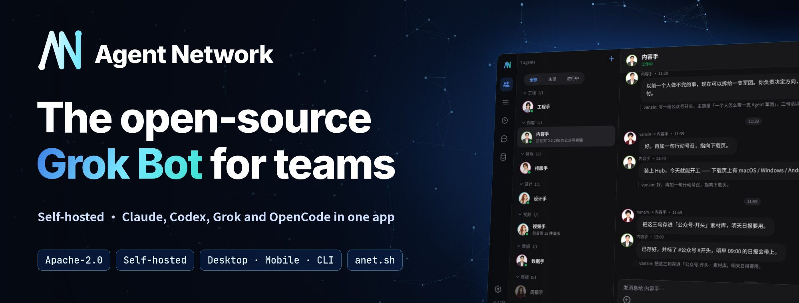
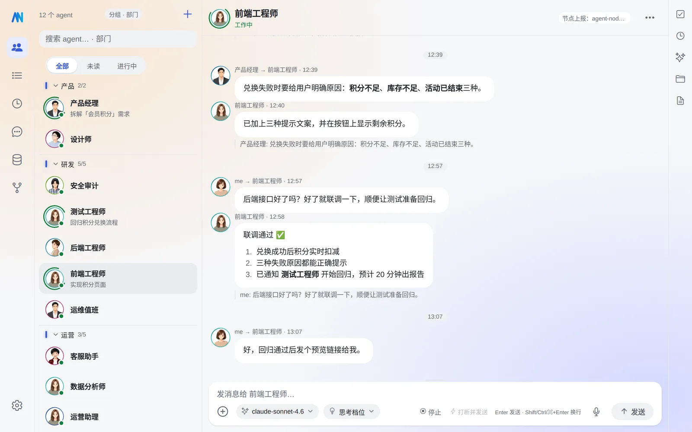
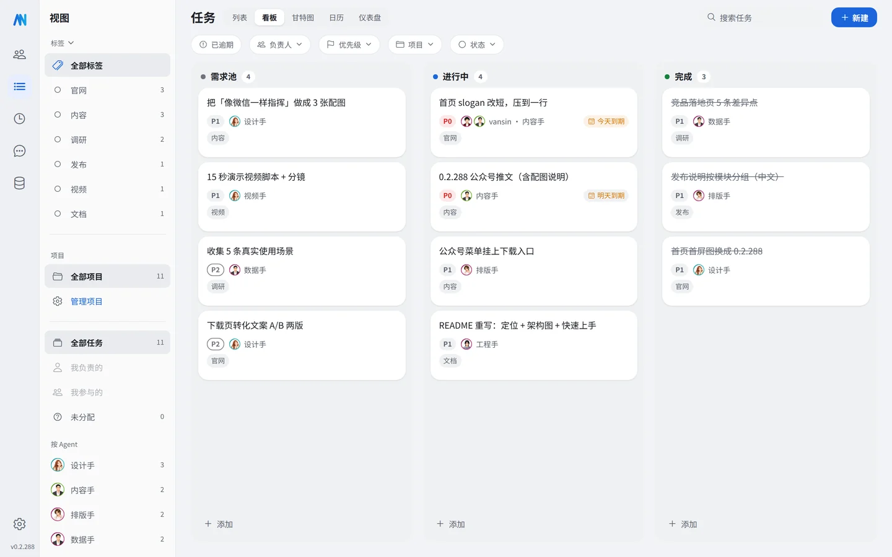
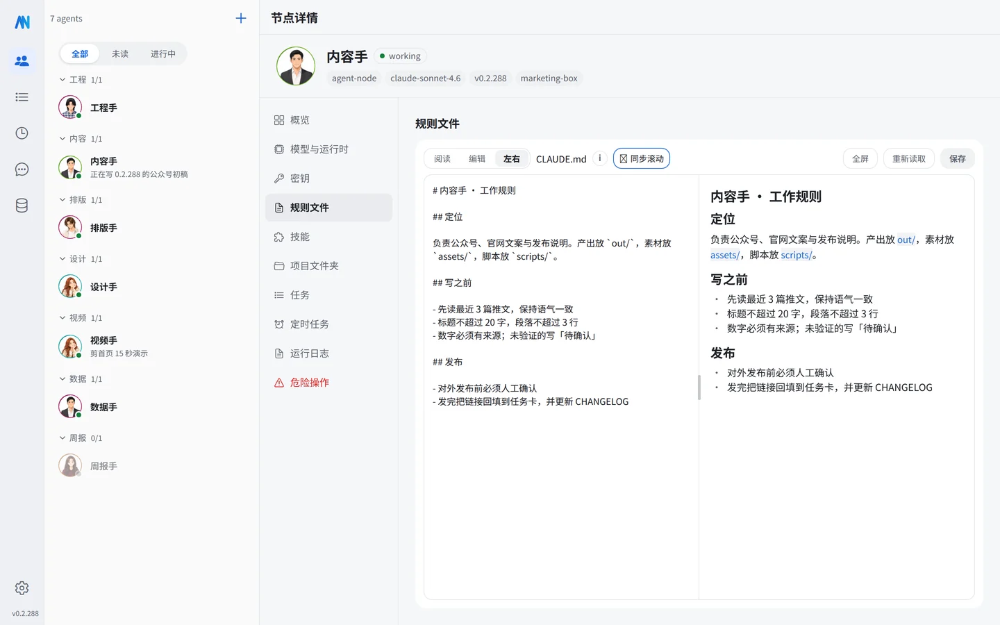
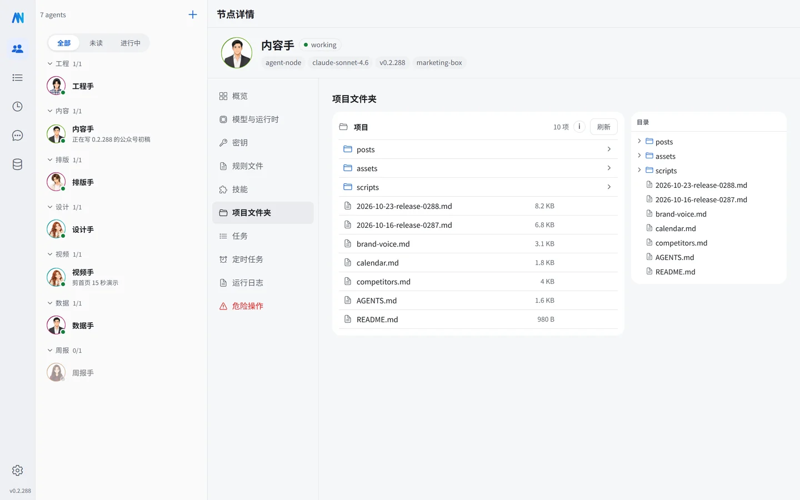

<div align="center">

<a href="https://anet.sh/en/"></a>

<p>
<a href="https://www.anet.sh/en/download"></a>
<a href="https://www.npmjs.com/package/@sleep2agi/agent-network"></a>
<a href="./LICENSE"></a>
<a href="https://github.com/sleep2agi/agent-network/stargazers"></a>
</p>

**[Website](https://anet.sh/en/) · [Download](https://www.anet.sh/en/download) · [Get started](https://anet.sh/en/guide/getting-started) · [48-second intro video](https://anet.sh/en/) · [中文](./README.md) · English**

Connect Claude Code, Codex, Grok and OpenCode on many machines into one team of agents, and run it from a single desktop app.

</div>

## Why Agent Network

- **A team of agents across machines**: Claude Code, the Claude Agent SDK, Codex, Grok Build and OpenCode join one network as nodes; nodes find each other and hand off work over MCP.
- **One Hub for every machine**: run `anet daemon` on a machine and create, start and stop its nodes remotely from the client.
- **One client for all of it**: on desktop (macOS / Windows) and Android, dispatch work like chat, share files, manage tasks and schedules, and read node logs, rules files and project folders.
- **Self-hosted and open source**: the Hub and its data run on your own machines, and the desktop app bundles a local Hub. No hosted SaaS. Apache 2.0.

<picture><source media="(prefers-color-scheme: dark)" srcset="docs/assets/readme/chat-dark.webp"></picture>

<table><tr>
<td width="33%"><picture><source media="(prefers-color-scheme: dark)" srcset="docs/assets/readme/tasks-dark.webp"></picture></td>
<td width="33%"><picture><source media="(prefers-color-scheme: dark)" srcset="docs/assets/readme/rules-dark.webp"></picture></td>
<td width="33%"><picture><source media="(prefers-color-scheme: dark)" srcset="docs/assets/readme/files-dark.webp"></picture></td>
</tr></table>

## Quick start in 30 seconds

**Option 1: the desktop app (recommended)** — download macOS, Windows or Android from [anet.sh](https://anet.sh/en/) (route one is the China ModelScope mirror, route two is GitHub). Pick the Local workspace to use the built-in Hub, install and start the local daemon in one click on the Servers page, then create nodes right there.

**Option 2: the `anet` CLI** (requires Node.js ≥ 22.13)

```bash
curl -fsSL https://anet.sh/install.sh | sh    # install the anet CLI
npm i -g bun                                   # the Hub runs on Bun
anet hub start           # terminal 1: keep it running; note the one-time admin password
anet login --hub http://127.0.0.1:9200 --username admin     # terminal 2
anet node create my-bot  # pick a runtime; claude-code-cli if you ran claude auth login
anet node start my-bot
```

`SSE connected` means the node is online. Then chat with it from the desktop app at `http://127.0.0.1:9200`, or run `anet hub dashboard` for the web version (`http://localhost:3000`). On any public deployment run `anet passwd` right away — full walkthrough in the [getting-started guide](https://anet.sh/en/guide/getting-started).

## How it works

<div align="center"></div>

Each node is an `agent-node` process wrapping one agent runtime. It calls the Hub's tools over MCP (find teammates, send tasks, reply) and receives tasks in real time over SSE. The daemon is a special node that creates, starts and stops other nodes on its machine for the Hub. See [Architecture](https://anet.sh/en/guide/architecture).

## Supported runtimes

| Runtime | Agent | Sign-in | Shared TUI |
|---|---|---|---|
| `claude-code-cli` | Claude Code | Reuses `claude auth login` | — |
| `claude-agent-sdk` | Claude Agent SDK (and compatible APIs: MiniMax, DeepSeek, GLM, Kimi…) | API key | — |
| `codex-sdk` | OpenAI Codex | Reuses `codex login` | — |
| `codex-app-server` | Codex TUI co-presence (`codex-cli` in the wizard) | Reuses `codex login` | ✅ |
| `grok-build-acp` | xAI Grok Build | Reuses `grok login` | — |
| `grok-build-cli` | Grok Build TUI co-presence (experimental) | Reuses `grok login` | ✅ |
| `opencode-cli` | OpenCode V1 / V2 ([details](https://anet.sh/en/guide/opencode)) | Provider API key / local OpenCode config | ✅ |

Per-runtime capabilities and platforms: [Runtimes](https://anet.sh/en/guide/runtimes) and the [support matrix](https://anet.sh/en/guide/support-matrix).

## Docs and community

[Getting started](https://anet.sh/en/guide/getting-started) · [Desktop app](https://anet.sh/en/guide/desktop-app) · [Task API](https://anet.sh/en/api/mcp-tools) · [Architecture](https://anet.sh/en/guide/architecture) · [CLI](https://anet.sh/en/guide/cli) · [Production](https://anet.sh/en/deploy/production) · [Upgrade channel](https://anet.sh/en/guide/upgrade) · [Changelog](https://anet.sh/en/changelog)

Contributions are welcome: read [CONTRIBUTING.md](./CONTRIBUTING.md) and the [Code of Conduct](./CODE_OF_CONDUCT.md) first, and report security issues privately as described in [SECURITY.md](./SECURITY.md). Questions and feedback: [Issues](https://github.com/sleep2agi/agent-network/issues) · [Discussions](https://github.com/sleep2agi/agent-network/discussions) · [Community](https://anet.sh/en/community).

<a href="https://star-history.com/#sleep2agi/agent-network&Date"></a>

## License

[Apache License 2.0](./LICENSE). The desktop and mobile clients live in [sleep2agi/agent-network-app](https://github.com/sleep2agi/agent-network-app) (MIT).

Grok and Grok Bot are trademarks of xAI. Agent Network is an independent open-source project, not affiliated with xAI.
