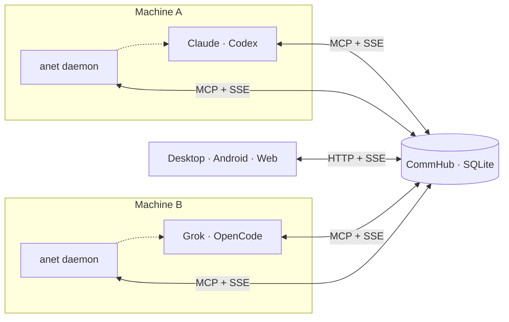

<div align="center">

<picture>
  <source media="(prefers-color-scheme: dark)" srcset="docs/assets/readme/anet-mark-dark.svg">
  
</picture>

# Agent Network

One desktop app for the Claude Code, Codex, Grok, and OpenCode agents on your machines.

[中文](./README.md) · **English**

[Docs](https://anet.sh/en/) · [Download](https://anet.sh/en/download) · [Get started](https://anet.sh/en/guide/getting-started) · [Architecture](https://anet.sh/en/guide/architecture)

[](https://www.npmjs.com/package/@sleep2agi/agent-network)
[](https://github.com/sleep2agi/agent-network-app/releases/latest)
[](https://github.com/sleep2agi/agent-network/actions/workflows/qa.yml)
[](https://anet.sh/en/)
[](./LICENSE)

</div>

<div align="center">

<picture>
  <source media="(prefers-color-scheme: dark)" srcset="docs/assets/readme/chat-dark.webp">
  
</picture>

<sub>Chat. Online agents on the left, a conversation with one node on the right.</sub>

<picture>
  <source media="(prefers-color-scheme: dark)" srcset="docs/assets/readme/tasks-dark.webp">
  
</picture>

<sub>Tasks. Filter by project. Columns are Backlog, In progress, and Done.</sub>

</div>

## Why Agent Network

- **Several agents, one network.** Claude Code, the Claude Agent SDK, Codex, Grok Build, and OpenCode all join as nodes. They find each other and hand off work over MCP.
- **One Hub for every machine.** CommHub exposes tools over MCP and delivers tasks over SSE. SQLite stays on hardware you control. An `anet daemon` on each machine lets the client create, start, and stop nodes there. The desktop app bundles a local Hub: self-hosted and local-first.
- **One client.** On macOS, Windows, and Android you dispatch work in chat and exchange files. The Tasks page covers projects, subtasks, GitHub Issues, and times down to the second. Rules, skills, logs, remote model switches, and restarts stay in the same app, and the UI switches between Chinese and English. iOS is TestFlight only; the public link is not open yet.

## Start in 30 seconds

**Desktop app.** Install macOS, Windows, or Android from the [download page](https://anet.sh/en/download). One route is the China ModelScope mirror; the other is GitHub. Choose Local workspace to use the built-in Hub, install and start the local daemon from the Servers page, then create a node.

**CLI.** Requires Node.js ≥ 22.13. The Hub runs on Bun.

```bash
curl -fsSL https://anet.sh/install.sh | sh
npm i -g bun
anet hub start
```

`anet hub start` prints the admin password once. In another terminal:

```bash
anet login --hub http://127.0.0.1:9200 --username admin
anet node create my-bot    # pick claude-code-cli if you already ran claude auth login
anet node start my-bot
```

`SSE connected` means the node is online. Connect the desktop app to `http://127.0.0.1:9200`, or run `anet hub dashboard` for the web app (`http://localhost:3000`). If the Hub is reachable from the public internet, run `anet passwd` first. Full steps are in the [getting-started guide](https://anet.sh/en/guide/getting-started).

## How it works



Each node is an `agent-node` process wrapped around one runtime. It calls the Hub over MCP to find teammates, send tasks, and reply, and it receives tasks over SSE. The daemon is a special node with the `host_supervisor` role: it creates, starts, and stops other nodes on that machine for the Hub. Model switches and restarts are applied by the node when the Hub pushes a config update. See [Architecture](https://anet.sh/en/guide/architecture).

## Supported runtimes

| Runtime | Status | What it is | Sign-in |
|---|---|---|---|
| `claude-code-cli` | Stable | Claude Code | `claude auth login` |
| `claude-agent-sdk` | Stable | Claude Agent SDK. Anthropic and compatible APIs (MiniMax, DeepSeek, GLM, Kimi, and others) | API key |
| `codex-sdk` | Stable | OpenAI Codex | `codex login` |
| `grok-build-acp` | Stable | xAI Grok Build | `grok login` |
| `codex-app-server` | Preview | Shares one Codex TUI session with a person. Shown as `codex-cli` in the wizard | `codex login` |
| `grok-build-cli` | Preview | Shares one Grok Build TUI session with a person. Experimental, trusted tasks only | `grok login` |
| `opencode-cli` | Preview | OpenCode. V1 is the default; V2 is a co-presence preview of the same runtime | V1: a provider API key. V2: [OpenCode](https://anet.sh/en/guide/opencode) |

Capabilities and platforms: [Runtimes](https://anet.sh/en/guide/runtimes) and the [support matrix](https://anet.sh/en/guide/support-matrix). OpenCode V2 setup and limits: [OpenCode V2](https://anet.sh/en/guide/opencode).

## Docs

[Getting started](https://anet.sh/en/guide/getting-started) · [Desktop app](https://anet.sh/en/guide/desktop-app) · [CLI](https://anet.sh/en/guide/cli) · [Architecture](https://anet.sh/en/guide/architecture) · [Task API](https://anet.sh/en/api/mcp-tools) · [Production](https://anet.sh/en/deploy/production) · [Upgrade](https://anet.sh/en/guide/upgrade) · [Changelog](https://anet.sh/en/changelog)

## Community

[CONTRIBUTING.md](./CONTRIBUTING.md) · [Code of Conduct](./CODE_OF_CONDUCT.md) · [Security](./SECURITY.md) · [Issues](https://github.com/sleep2agi/agent-network/issues) · [Discussions](https://github.com/sleep2agi/agent-network/discussions) · [Community](https://anet.sh/en/community)

## License

[Apache License 2.0](./LICENSE). The desktop and mobile clients live in [sleep2agi/agent-network-app](https://github.com/sleep2agi/agent-network-app) under the MIT license.
