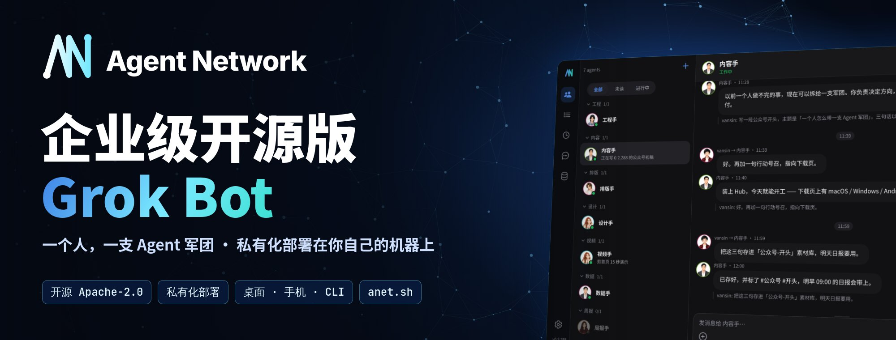

<div align="center">

<a href="https://anet.sh"></a>

<p>
<a href="https://www.anet.sh/download"></a>
<a href="https://www.npmjs.com/package/@sleep2agi/agent-network"></a>
<a href="./LICENSE"></a>
<a href="https://github.com/sleep2agi/agent-network/stargazers"></a>
</p>

**[官网](https://anet.sh) · [下载桌面版](https://www.anet.sh/download) · [快速上手](https://anet.sh/guide/getting-started) · [48 秒介绍视频](https://anet.sh) · 中文 · [English](./README.en.md)**

把多台机器上的 Claude Code、Codex、Grok、OpenCode 连成一支 Agent 军团，在一个桌面应用里像微信一样指挥它们。

</div>

<picture><source media="(prefers-color-scheme: dark)" srcset="docs/assets/readme/chat-dark.webp"></picture>

<table>
<tr>
<td width="33%" valign="top">

### 🤝 一支会协作的团队
Claude Code、Codex、Grok、OpenCode 都能当队员。它们互相派活、互相回话，你只管说一句要什么。

</td>
<td width="33%" valign="top">

### 💬 像微信一样指挥
桌面、手机都能聊天派活、看进度、停下正在跑的任务；定时任务、文件、日志都在对话旁边。

</td>
<td width="33%" valign="top">

### 🔒 部署在你自己的机器上
Hub 和数据都在你自己的服务器上，开源 Apache-2.0。桌面版自带本地 Hub，装完就能用。

</td>
</tr>
</table>

## 三步开始

1. **[下载桌面版](https://www.anet.sh/download)**（macOS · Windows · Android）
2. 打开后选「本地工作区」，点「＋」新建一个 agent
3. 跟它说第一句话

<details>
<summary><b>用命令行部署 Hub（服务器 / 团队共用）</b></summary>

需要 Node.js ≥ 22.13：

```bash
curl -fsSL https://anet.sh/install.sh | sh
npm i -g bun
anet hub start                                               # 记下只打印一次的 admin 密码
anet login --hub http://127.0.0.1:9200 --username admin
anet node create my-bot && anet node start my-bot
```

看到 `SSE connected` 就上线了。公网部署请先 `anet passwd` 改密，完整步骤见 [上手指南](https://anet.sh/guide/getting-started)。

</details>

<details>
<summary><b>支持哪些 Agent 运行时</b></summary>

| 运行时 | 登录方式 |
|---|---|
| Claude Code / Claude Agent SDK（及 DeepSeek、Kimi、GLM、MiniMax 等兼容 API） | `claude auth login` 或 API Key |
| OpenAI Codex | `codex login` |
| xAI Grok Build | `grok login` |
| OpenCode V1 / V2 | 提供方 API Key 或本机 OpenCode 配置 |

能力对比见 [Runtime 对比](https://anet.sh/guide/runtimes)，原理见 [架构说明](https://anet.sh/guide/architecture)。

</details>

## 文档与社区

[上手指南](https://anet.sh/guide/getting-started) · [桌面应用](https://anet.sh/guide/desktop-app) · [任务 API](https://anet.sh/api/mcp-tools) · [架构](https://anet.sh/guide/architecture) · [CLI](https://anet.sh/guide/cli) · [生产部署](https://anet.sh/deploy/production) · [升级通道](https://anet.sh/guide/upgrade) · [更新日志](https://anet.sh/changelog)

欢迎贡献：先读 [CONTRIBUTING.md](./CONTRIBUTING.md) 和 [行为准则](./CODE_OF_CONDUCT.md)，安全问题请按 [SECURITY.md](./SECURITY.md) 私下报告。提问和反馈：[Issues](https://github.com/sleep2agi/agent-network/issues) · [Discussions](https://github.com/sleep2agi/agent-network/discussions) · [社群](https://anet.sh/community)。

## 许可证

[Apache License 2.0](./LICENSE)。桌面与移动客户端源码在 [sleep2agi/agent-network-app](https://github.com/sleep2agi/agent-network-app)（MIT）。

Grok 与 Grok Bot 是 xAI 的商标；Agent Network 是独立的开源项目，与 xAI 无关联。
