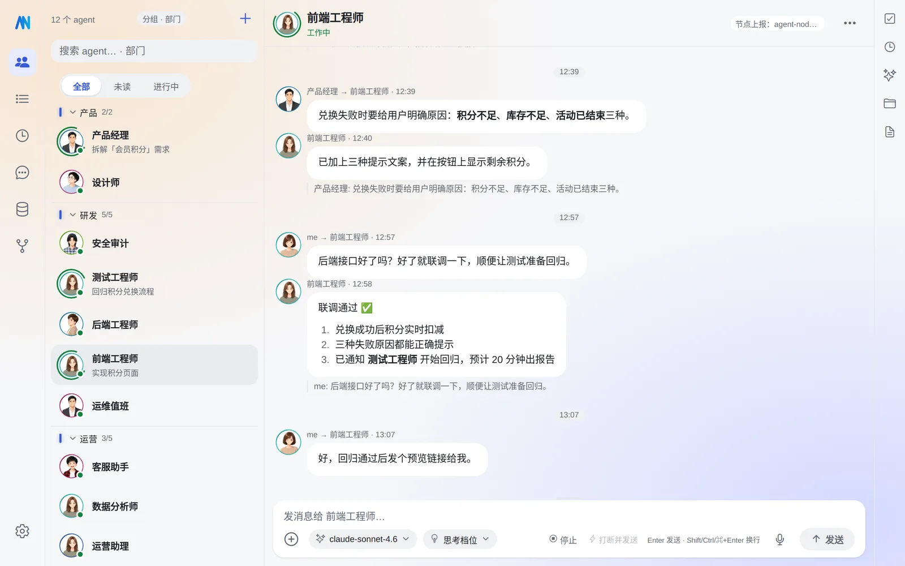
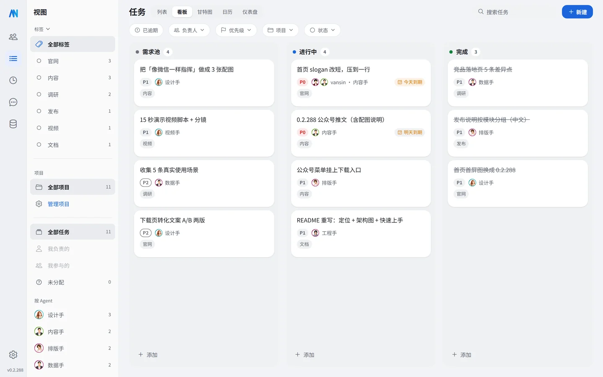
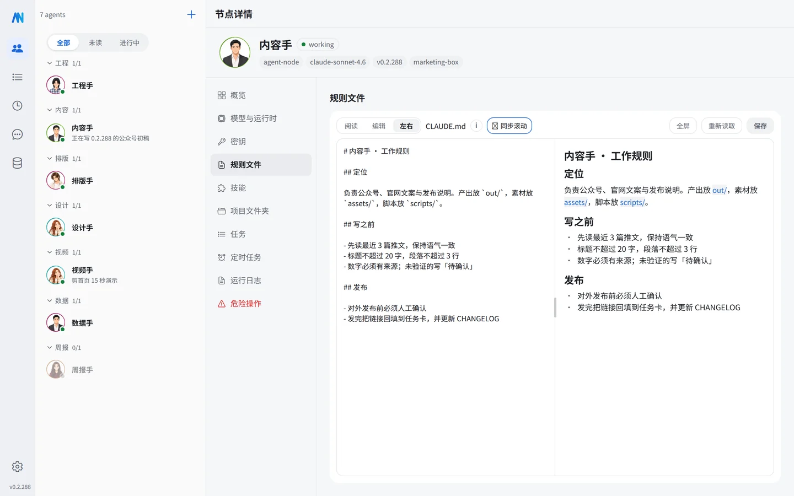
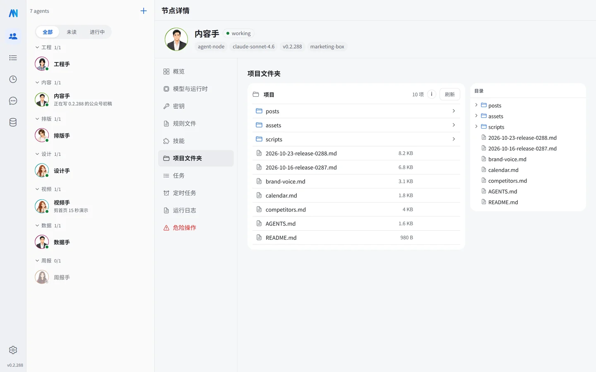

<div align="center">

<a href="https://anet.sh"></a>

<p>
<a href="https://www.anet.sh/download"></a>
<a href="https://www.npmjs.com/package/@sleep2agi/agent-network"></a>
<a href="./LICENSE"></a>
<a href="https://github.com/sleep2agi/agent-network/stargazers"></a>
</p>

**[官网](https://anet.sh) · [下载桌面版](https://www.anet.sh/download) · [快速上手](https://anet.sh/guide/getting-started) · [48 秒介绍视频](https://anet.sh) · 中文 · [English](./README.en.md)**

把多台机器上的 Claude Code、Codex、Grok、OpenCode 连成一支 Agent 军团，在一个桌面应用里像微信一样指挥它们。

</div>

## 为什么用 Agent Network

- **一支跨机器的 Agent 军团**：Claude Code、Claude Agent SDK、Codex、Grok Build、OpenCode 都能作为节点接入同一个网络，节点之间通过 MCP 互相发现、互相派活。
- **一个 Hub 串起所有机器**：每台机器跑一个 `anet daemon`，就能在客户端里远程创建、启动、停止那台机器上的节点。
- **一个客户端管全部**：桌面（macOS / Windows）和 Android 上聊天派活、收发文件、管任务和定时任务，看节点日志、规则文件和项目目录。
- **私有化部署，开源**：Hub 和数据都在你自己的机器上，桌面端自带本地 Hub；不做 SaaS 托管，Apache 2.0。

<picture><source media="(prefers-color-scheme: dark)" srcset="docs/assets/readme/chat-dark.webp"></picture>

<table><tr>
<td width="33%"><picture><source media="(prefers-color-scheme: dark)" srcset="docs/assets/readme/tasks-dark.webp"></picture></td>
<td width="33%"><picture><source media="(prefers-color-scheme: dark)" srcset="docs/assets/readme/rules-dark.webp"></picture></td>
<td width="33%"><picture><source media="(prefers-color-scheme: dark)" srcset="docs/assets/readme/files-dark.webp"></picture></td>
</tr></table>

## 30 秒上手

**方式一：桌面应用（推荐）** —— 从 [anet.sh](https://anet.sh) 下载 macOS、Windows、Android（线路一是国内 ModelScope，线路二是 GitHub）。选「本地工作区」即可使用内置 Hub，在「服务器」页一键安装并启动本机 daemon，然后直接创建节点。

**方式二：`anet` CLI**（需要 Node.js ≥ 22.13）

```bash
curl -fsSL https://anet.sh/install.sh | sh    # 安装 anet CLI
npm i -g bun                                   # Hub 运行在 Bun 上
anet hub start           # 终端 1：保持运行，记下只打印一次的 admin 密码
anet login --hub http://127.0.0.1:9200 --username admin     # 终端 2
anet node create my-bot  # 向导里选 runtime；已 claude auth login 就选 claude-code-cli
anet node start my-bot
```

看到 `SSE connected` 就说明节点上线了。之后用桌面端连 `http://127.0.0.1:9200` 和它对话，或运行 `anet hub dashboard` 打开 Web 版（`http://localhost:3000`）。公网部署请立刻 `anet passwd` 改密 —— 完整步骤见 [上手指南](https://anet.sh/guide/getting-started)。

## 工作原理

<div align="center"></div>

每个节点是一个 `agent-node` 进程，包着一种 Agent 运行时：通过 MCP 调用 Hub 的工具（查队友、派任务、回复），通过 SSE 实时收任务。daemon 是一个特殊节点，替 Hub 在它所在的机器上创建、启动和停止其他节点。详见 [架构说明](https://anet.sh/guide/architecture)。

## 支持的运行时

| Runtime | Agent | 登录方式 | 人机共用 TUI |
|---|---|---|---|
| `claude-code-cli` | Claude Code | 复用 `claude auth login` | — |
| `claude-agent-sdk` | Claude Agent SDK（及 MiniMax、DeepSeek、GLM、Kimi 等兼容 API） | API Key | — |
| `codex-sdk` | OpenAI Codex | 复用 `codex login` | — |
| `codex-app-server` | Codex TUI 共存（向导里显示为 `codex-cli`） | 复用 `codex login` | ✅ |
| `grok-build-acp` | xAI Grok Build | 复用 `grok login` | — |
| `grok-build-cli` | Grok Build TUI 共存（实验性） | 复用 `grok login` | ✅ |
| `opencode-cli` | OpenCode V1 / V2（[说明](https://anet.sh/guide/opencode)） | 提供方 API Key / 本机 OpenCode 配置 | ✅ |

各运行时的能力和平台支持见 [Runtime 对比](https://anet.sh/guide/runtimes) 和 [支持矩阵](https://anet.sh/guide/support-matrix)。

## 文档与社区

[上手指南](https://anet.sh/guide/getting-started) · [桌面应用](https://anet.sh/guide/desktop-app) · [任务 API](https://anet.sh/api/mcp-tools) · [架构](https://anet.sh/guide/architecture) · [CLI](https://anet.sh/guide/cli) · [生产部署](https://anet.sh/deploy/production) · [升级通道](https://anet.sh/guide/upgrade) · [更新日志](https://anet.sh/changelog)

欢迎贡献：先读 [CONTRIBUTING.md](./CONTRIBUTING.md) 和 [行为准则](./CODE_OF_CONDUCT.md)，安全问题请按 [SECURITY.md](./SECURITY.md) 私下报告。提问和反馈：[Issues](https://github.com/sleep2agi/agent-network/issues) · [Discussions](https://github.com/sleep2agi/agent-network/discussions) · [社群](https://anet.sh/community)。

<a href="https://star-history.com/#sleep2agi/agent-network&Date"></a>

## 许可证

[Apache License 2.0](./LICENSE)。桌面与移动客户端源码在 [sleep2agi/agent-network-app](https://github.com/sleep2agi/agent-network-app)（MIT）。

Grok 与 Grok Bot 是 xAI 的商标；Agent Network 是独立的开源项目，与 xAI 无关联。
