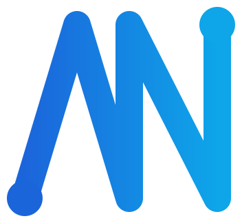
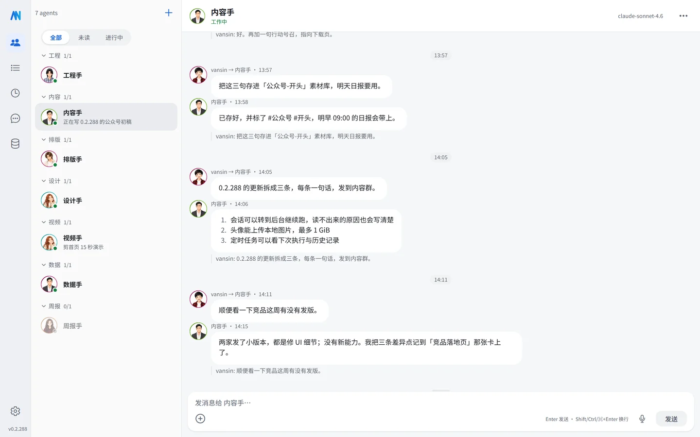
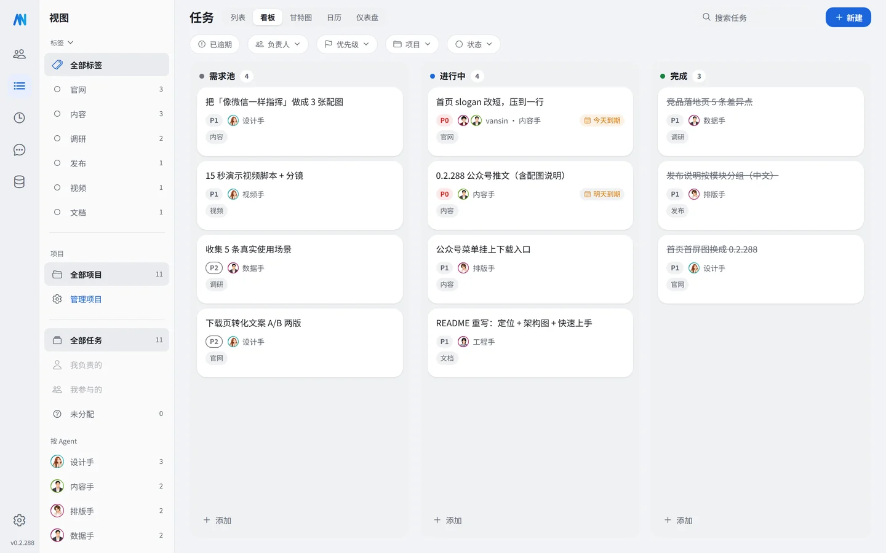
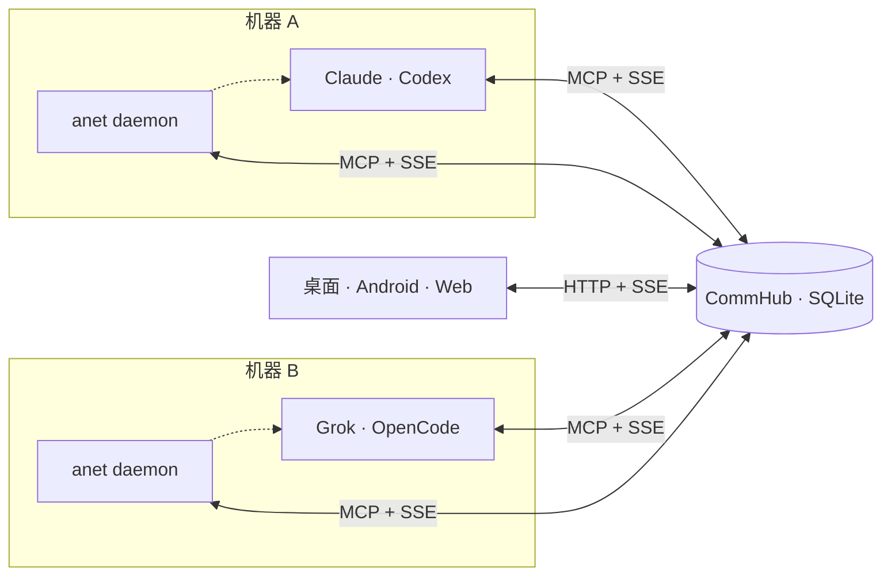

<div align="center">

<picture>
  <source media="(prefers-color-scheme: dark)" srcset="docs/assets/readme/anet-mark-dark.svg">
  
</picture>

# Agent Network

一个桌面应用，指挥多台机器上的 Claude Code、Codex、Grok 和 OpenCode。

**中文** · [English](./README.en.md)

[文档](https://anet.sh) · [下载](https://anet.sh/download) · [快速上手](https://anet.sh/guide/getting-started) · [架构](https://anet.sh/guide/architecture)

[](https://www.npmjs.com/package/@sleep2agi/agent-network)
[](https://github.com/sleep2agi/agent-network-app/releases/latest)
[](https://github.com/sleep2agi/agent-network/actions/workflows/qa.yml)
[](https://anet.sh)
[](./LICENSE)

</div>

<div align="center">

<picture>
  <source media="(prefers-color-scheme: dark)" srcset="docs/assets/readme/chat-dark.webp">
  
</picture>

<sub>聊天。左侧是在线 Agent，右侧是与一个节点的对话。</sub>

<picture>
  <source media="(prefers-color-scheme: dark)" srcset="docs/assets/readme/tasks-dark.webp">
  
</picture>

<sub>任务。按项目筛选，看板分需求池、进行中、完成。</sub>

</div>

## 为什么用 Agent Network

- **多种 Agent，同一张网。** Claude Code、Claude Agent SDK、Codex、Grok Build、OpenCode 都以节点接入，通过 MCP 互相发现、互相派活。
- **一个 Hub，管多台机器。** CommHub 用 MCP 暴露工具、用 SSE 投递任务，SQLite 留在你自己的机器上。每台机器跑一个 `anet daemon`，就能从客户端创建、启动和停止那台机器上的节点。桌面端自带本地 Hub，自托管、本地优先。
- **一个客户端。** macOS、Windows、Android 上聊天派活、收发文件；任务页管理项目、子任务、GitHub Issue，时间精确到秒。规则、技能、日志、远程切模型和重启都在同一个应用里，界面可切换中英文。iOS 只走 TestFlight，公开链接还没开。

## 30 秒上手

**桌面应用。** 从 [下载页](https://anet.sh/download) 安装 macOS、Windows 或 Android。国内线路是 ModelScope，另一条是 GitHub。打开后选「本地工作区」使用内置 Hub，在「服务器」页一键安装并启动本机 daemon，然后创建节点。

**命令行。** 需要 Node.js ≥ 22.13。Hub 跑在 Bun 上。

```bash
curl -fsSL https://anet.sh/install.sh | sh
npm i -g bun
anet hub start
```

`anet hub start` 只打印一次 admin 密码。换一个终端：

```bash
anet login --hub http://127.0.0.1:9200 --username admin
anet node create my-bot    # 已经 claude auth login 就选 claude-code-cli
anet node start my-bot
```

看到 `SSE connected`，节点就在线了。用桌面端连接 `http://127.0.0.1:9200`，或运行 `anet hub dashboard` 打开 Web 版（`http://localhost:3000`）。Hub 暴露到公网时，先执行 `anet passwd`。完整步骤见 [上手指南](https://anet.sh/guide/getting-started)。

## 工作原理



每个节点是一个 `agent-node` 进程，包着一种运行时。它通过 MCP 调用 Hub 查队友、派任务、回复，通过 SSE 收任务。daemon 是角色为 `host_supervisor` 的特殊节点，替 Hub 在本机创建、启动和停止其他节点；切模型和重启由节点自己执行 Hub 下发的配置。详见 [架构说明](https://anet.sh/guide/architecture)。

## 支持的运行时

| Runtime | 状态 | 说明 | 登录 |
|---|---|---|---|
| `claude-code-cli` | 正式 | Claude Code | `claude auth login` |
| `claude-agent-sdk` | 正式 | Claude Agent SDK。Anthropic 及兼容 API（MiniMax、DeepSeek、GLM、Kimi 等） | API Key |
| `codex-sdk` | 正式 | OpenAI Codex | `codex login` |
| `grok-build-acp` | 正式 | xAI Grok Build | `grok login` |
| `codex-app-server` | 预览 | 与人共用一个 Codex TUI 会话。向导里显示为 `codex-cli` | `codex login` |
| `grok-build-cli` | 预览 | 与人共用一个 Grok Build TUI 会话。实验性，仅可信任务 | `grok login` |
| `opencode-cli` | 预览 | OpenCode。默认 V1；V2 是同一 runtime 的共存预览 | V1 用提供方 API Key。V2 见 [OpenCode](https://anet.sh/guide/opencode) |

能力与平台见 [Runtime 对比](https://anet.sh/guide/runtimes) 和 [支持矩阵](https://anet.sh/guide/support-matrix)。OpenCode V2 的创建方式和限制见 [OpenCode V2](https://anet.sh/guide/opencode)。

## 文档

[上手指南](https://anet.sh/guide/getting-started) · [桌面应用](https://anet.sh/guide/desktop-app) · [CLI](https://anet.sh/guide/cli) · [架构](https://anet.sh/guide/architecture) · [任务 API](https://anet.sh/api/mcp-tools) · [生产部署](https://anet.sh/deploy/production) · [升级](https://anet.sh/guide/upgrade) · [更新日志](https://anet.sh/changelog)

## 参与

[CONTRIBUTING.md](./CONTRIBUTING.md) · [行为准则](./CODE_OF_CONDUCT.md) · [安全问题](./SECURITY.md) · [Issues](https://github.com/sleep2agi/agent-network/issues) · [Discussions](https://github.com/sleep2agi/agent-network/discussions) · [社群](https://anet.sh/community)

## 许可证

[Apache License 2.0](./LICENSE)。桌面与移动客户端在 [sleep2agi/agent-network-app](https://github.com/sleep2agi/agent-network-app)，许可证为 MIT。
